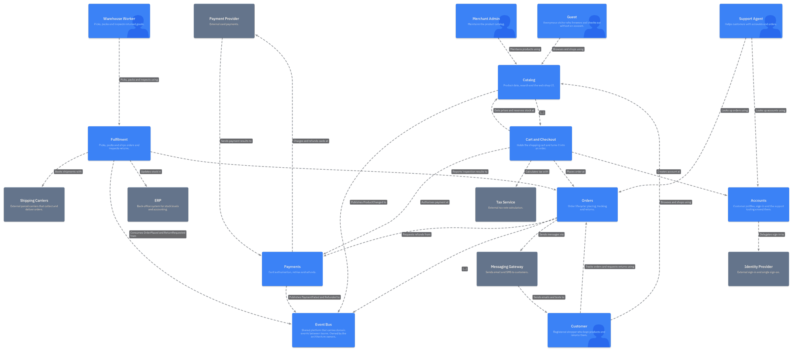

# architecture-as-code

Keep a multi-team C4 architecture model as code in git, using [LikeC4](https://likec4.dev).
Each team owns its folder, changes go through pull request review, and CI checks the model.

The project started as a comparison of Structurizr and LikeC4. LikeC4 won (see
[ADR 0006](docs/decisions/0006-likec4-is-the-tool-of-record.md)).

## Who it is for

- Teams whose architecture diagrams drift out of date, or live in one person's drawing tool.
- Organisations where several teams edit one shared model at the same time.
- Anyone who wants architecture changes reviewed like code, with `CODEOWNERS` per folder.

## The example



[`examples/shop`](examples/shop/README.md) is a fictional web shop with six domain teams
and an architecture team. It has one folder per team, every C4 level (context, container,
component and deployment, with `kubernetes_*` metadata), dynamic views, a menu folder per
team, and written multi-user scenarios such as parallel edits and merge conflicts.

[View the model](https://jakos.github.io/architecture-as-code/) as a browsable LikeC4 site,
published from `main` on GitHub Pages.
[Try the editor](https://jakos.github.io/architecture-as-code/editor/) in the browser on the same
model: a demo, your edits stay in the tab and are not saved.

## Quick start

Needs: [uv](https://docs.astral.sh/uv/), [just](https://just.systems/), Podman or Docker.

```
uv sync
uv run prek install
just check                  # validate everything
just up                     # http://127.0.0.1:8080 renders examples/shop live
just site                   # http://127.0.0.1:8081 static site of examples/shop
just down                   # stop both
just viewer-up              # read-only viewer on :8082 (main; branches via just viewer-build <ref>)
```

`uv run prek install` is optional. It installs git hooks from `prek.toml`: formatting and
lint checks on commit, tests and model validation on push.

Using Docker instead of Podman: copy `.env.example` to `.env` and set
`CONTAINER_ENGINE=docker`. To serve another project, run `MODEL=<dir> just up`.

## Status

Early draft. [docs/workflow.md](docs/workflow.md) has the detail.

| Works today | Not yet |
| --- | --- |
| Edit `.c4` files in the repo, live render with `just up` | Browser editor that opens PRs: local proof of concept only, it commits to a `model/*` branch and does not open the PR itself |
| Validation gate locally, on pre-push and in CI (`just check`) | Drift check against Kubernetes, read-only (planned) |
| Static site built and served locally (`just site`) | Generating Kubernetes objects (planned) |
| Example site published on GitHub Pages from `main` (CI), with a demo of the model editor under `/editor/` (nothing is saved) | |
| Example multi-team model in `examples/shop` | |

## Docs

- [Workflow](docs/workflow.md): edit in repo, browser editor → PR, deploy
- [Conventions](docs/conventions.md): Kubernetes metadata keys, project layout
- [Decisions](docs/decisions/): ADRs, including
  [ADR 0006](docs/decisions/0006-likec4-is-the-tool-of-record.md)
- [Shop example](examples/shop/README.md)
- [Research](docs/research/): background notes, written before the switch to LikeC4

## Built on LikeC4

This project is built on [LikeC4](https://likec4.dev)
([likec4/likec4](https://github.com/likec4/likec4), MIT licence). It is a separate project, not
part of LikeC4 or endorsed by it. Validation, formatting, the live diagram and the static
site all come from the pinned LikeC4 image. The browser editor is the LikeC4 playground,
built from source at the pinned tag with a small patch set
([`docker/editor/model-editor`](docker/editor/model-editor/README.md),
[ADR 0007](docs/decisions/0007-model-editor-on-likec4-playground.md)). The editor image is
released as LikeC4 Model Editor: edit a LikeC4 architecture model in the browser and propose
changes for review, no git knowledge needed
([ADR 0012](docs/decisions/0012-release-the-editor-image-as-likec4-model-editor.md)).
Community project based on LikeC4, not affiliated with it (nor endorsed by it). This repo adds the
model layout, team ownership, CI checks, the editor's server and the git workflow.

## License

[MIT](LICENSE)
